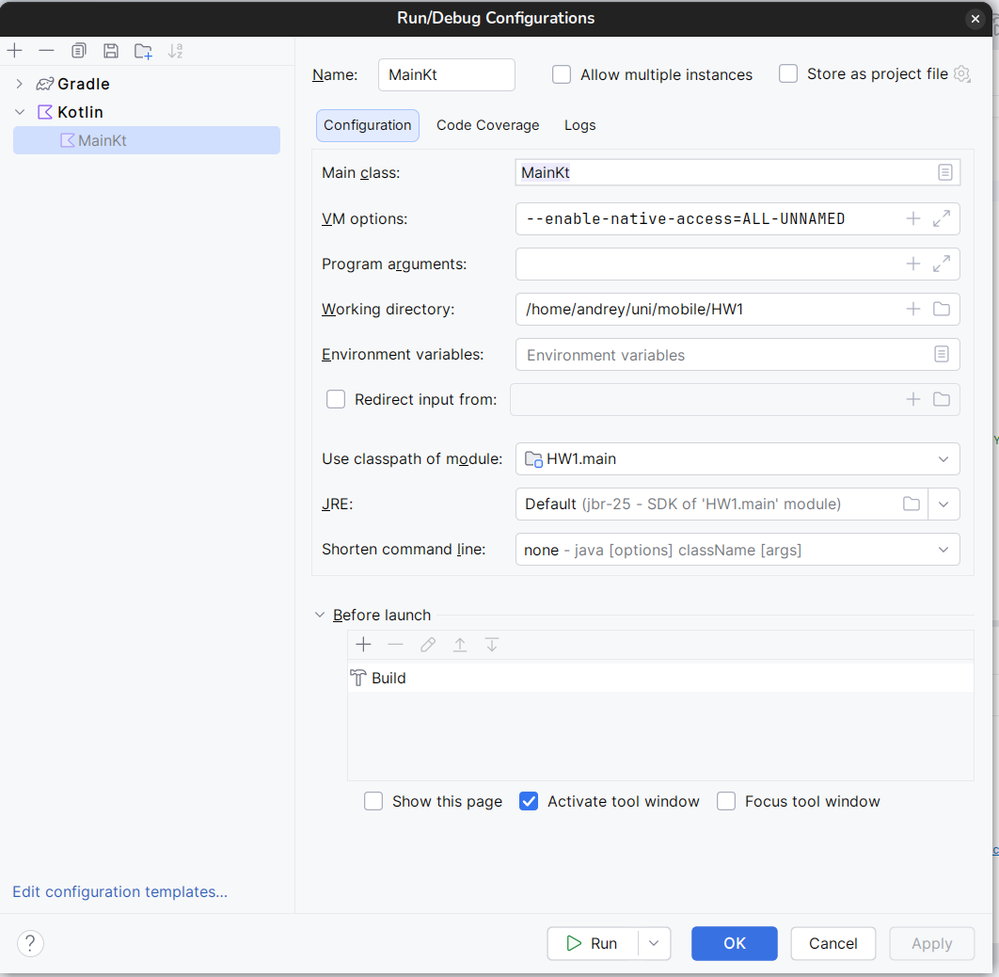

# Project for Homework1 VERY_NEW_CLI_WSP
### With codename HW1

## Description
 The project implements existing University's portal functionality in the CLI Kotlin based application

There exist 3 types of users: Manager, Teacher and Student

#### Manager can:
- Accept or reject user registration requests
- Add new courses and classes _(coming soon)_
- Sign Students and Teachers for the class _(coming soon)_
- _by default the only user in the system is Manager admin with username `admin` and password `12345`_

#### Teacher can:
- Put marks for Students for the class they're assigned _(coming soon)_
- View the timetable

#### Student can:
- View marks for the class they're assigned _(coming soon)_
- View the timetable

## How to run

~Honestly, IDK if it will run anywhere but my laptop, but in case you're lucky~

You have to have either IntelliJ Idea or Android Studio
The configuration should be like this:

## Used Principles

- Variables, data types, conditions, and loops - `Everywhere`
- List, Set, and Map - `CLI.kt: 80, 160`
- Collection operations including map, filter, and reduce `CLI.kt: 60`
- Functions, higher-order functions, and lambdas `CLI: 110 for example`
- Classes and objects - `DbManager, User, Teacher, Student, Manager`
- Inheritance - `User and it's subclasses(Teacher, Student, Manager)`
- Interfaces and polymorphism - `User and its realisation in DbManager:134 for example`
- At least one data class - `DbManager:331 (UserRequest)`
- At least one sealed class - `Main: 297 (AuthResponse)`
- At least one suspend function and a simple coroutine
